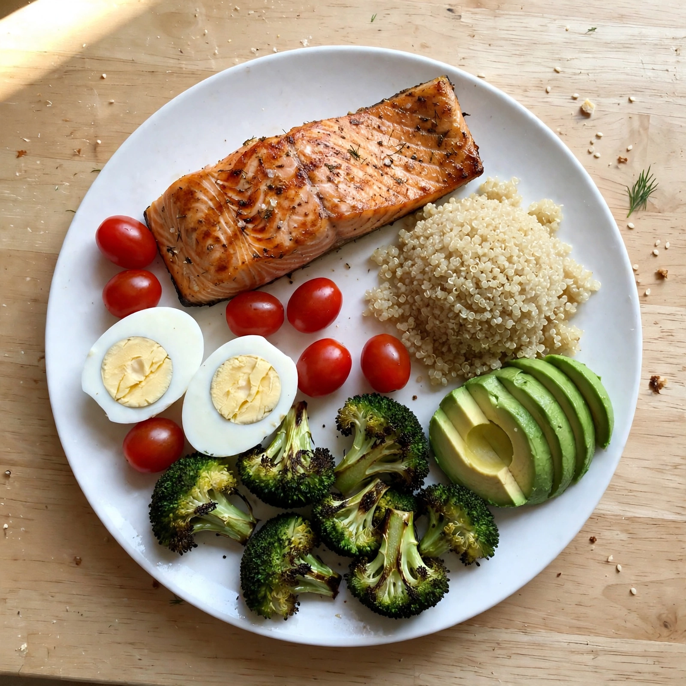
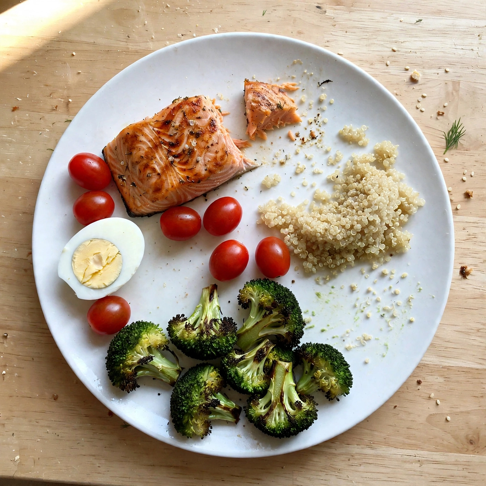

<p align="center">
  
</p>

<h1 align="center">GLPfit · 지엘피핏</h1>

<p align="center"><a href="README.md">English</a> · <b>한국어</b></p>

<p align="center">
  <b>마운자로·위고비 사용자의 일주일을 함께하는 기록 앱</b><br/>
  체중, 투약, 사진으로 남기는 식사, 운동을 기록하고 주사 주기에 맞춰 Meta AI 코치와 대화합니다.
</p>

<p align="center">
  
  
  <br/><sub>Plate Lens는 식사 전후 사진을 비교해 실제로 먹은 양과 단백질을 추정합니다.</sub>
</p>

## 데모 영상

[YouTube에서 2분 48초 영어 데모 보기](https://youtu.be/DEE4_cbdePg)

영어 내레이션, 기능별 설명, 영어 자막을 넣었습니다. 가상의 사용자 Minji로 촬영한 앱 화면이며, 긴 대기 구간은 편집했습니다. [영상 다운로드](https://github.com/orqan137/glpfit/raw/refs/heads/main/glpfit-demo-final.mp4)와 [영어 자막 파일](glpfit-demo-final.en.srt)도 제공합니다.

## 왜 만들었나요?

마운자로(티르제파타이드, GIP/GLP-1 이중 작용)와 위고비(세마글루타이드, GLP-1)는 주 1회 투여하는 주사제입니다. 주사 후 며칠째인지에 따라 식욕과 컨디션이 달라질 수 있습니다. 체중이 줄어드는 동안 충분한 단백질 섭취와 근력 운동을 챙기는 일도 중요합니다.

지엘피핏은 **“오늘은 주사를 맞은 지 며칠째이고, 무엇을 기록하고 실천하면 좋을까?”**에 초점을 맞췄습니다. 복잡한 식사 일지 대신 사진을 사용하고, 체중·투약·식사·운동 네 가지 기록을 한 흐름으로 연결합니다.

## 주요 기능

| 기능 | 내용 |
| --- | --- |
| **홈** | 체중, 주사 주기, 오늘의 단백질, 운동 세트를 네 개의 카드로 확인합니다. |
| **투약** | 마운자로·위고비 투약 기록, 다음 주사일, 주사 부위 순환, 제품 라벨에 따른 투약 누락 참고 정보, 남은 펜 수와 병원 방문 시점을 보여 줍니다. 부작용을 기록하고, 라벨의 반감기로 계산한 상대적 약물 수준 추정 곡선을 확인합니다. |
| **식사** | 사진에서 음식을 찾아 단백질과 열량을 추정합니다. 식사 후 사진을 더하면 남은 양과 실제 섭취량을 추정해 오늘의 기록에 반영합니다. |
| **운동** | 주사 직후에는 가벼운 움직임, 컨디션이 안정적인 날에는 근력 운동 중심의 루틴을 제공합니다. 직접 운동을 추가하고 횟수·시간·세트를 기록할 수 있습니다. |
| **코치** | 앱의 기록과 도구를 활용해 주사 주기에 맞는 생활 관리 정보를 설명합니다. 필요한 사용자 선호를 기억하며 한국어와 영어로 대화합니다. |
| **진료용 PDF** | 최근 30일의 체중, 용량 이력, 주사 후 날짜별 증상, 사진으로 추정한 단백질 기록을 표로 출력합니다. 기본 기록 표는 AI 호출 없이 생성하며, 선택적으로 AI 요약과 진료 때 물어볼 질문을 추가합니다. 요약 생성에 실패해도 기록 표는 유지됩니다. |

## Meta AI 활용

| 모델 | 활용 방식 |
| --- | --- |
| **SAM 3.1** | 식사 전후 사진의 음식별 개수와 경계 상자 면적을 비교합니다. 단순히 분할 결과를 보여 주는 데서 그치지 않고 섭취 비율을 추정하는 측정 보조 수단으로 사용합니다. |
| **Muse Spark · 비전 및 구조화 출력** | 음식 이름, 단백질, 열량, 남은 비율을 정해진 JSON 형식으로 추정합니다. SAM의 공간 정보와 교차 확인하고, SAM이 음식을 놓치면 비전 추정값을 사용합니다. |
| **Muse Spark · 에이전트** | 코치가 투약 일정과 서버에서 계산한 추세를 도구로 조회하고, 대화 맥락을 이어 가며 사용자 선호를 기억합니다. |
| **Muse Spark · 구조화 출력** | 서버에서 계산한 사실을 바탕으로 선택형 진료용 요약을 작성합니다. |
| **Muse Voice Transcribe** | 음성을 일일 기록으로 변환하는 `/api/voice-checkin` 엔드포인트를 구현했습니다. 음성 입력 화면은 향후 개발 항목입니다. |
| **Muse Image** | 저장소에 포함한 식사 전후 샘플 사진을 생성하고 편집했습니다. |

### 코치 에이전트 구조

OpenClaw·Hermes와 같은 에이전트의 작업 공간 파일 구성을 참고했습니다.

- [`SOUL.md`](glpfit/agent/glpfit_agent/prompts/SOUL.md): 코치의 역할, 말투, 안전 원칙을 정의합니다.
- [`AGENTS.md`](glpfit/agent/glpfit_agent/prompts/AGENTS.md): 턴별 작업 방식, 도구 사용과 응답 형식을 정의합니다.
- 요청마다 `TODAY`(날짜·언어), `USER`(프로필·주사 주기·오늘의 기록), `MEMORY`(저장된 사용자 선호)를 구성합니다.

도구는 `get_progress`, `get_medication_schedule`, `get_coaching_tips`, `remember`입니다. 수치와 추세는 서버에서 계산해 모델의 산술 오류를 줄입니다. `remember`는 이미 저장된 사실을 중복 기록하지 않습니다. Meta Responses API 호출은 `store=False`를 사용하며, 여러 단계의 도구 호출에 필요한 암호화된 reasoning 항목을 이어서 전달합니다.

## 안전과 기록의 한계

- 진단·처방을 하지 않으며 투약 용량 변경을 권하지 않습니다. 용량 단계는 제품 라벨 참고 정보입니다.
- 약물 수준 곡선은 라벨의 반감기로 계산한 추정치이며, 실제로 측정한 혈중 농도가 아닙니다.
- 사용자가 입력한 기록과 사진 기반 영양 추정값을 구분합니다. 사진만으로 실제 섭취 영양소를 정확히 측정할 수는 없습니다.
- 심한 증상은 의료진에게 문의하도록 안내합니다.
- 개인 기록은 브라우저에 보관합니다. 코칭, 사진 분석, 선택형 AI 요약 등을 요청할 때 해당 기능에 필요한 데이터가 서버로 전송됩니다. API 키는 서버에서만 읽습니다.

## 내 기록에서 진료와 연구까지

1. **개인 기록**: 전체 데이터를 JSON으로 내보내거나 진료용 PDF를 출력합니다.
2. **진료**: 월별 기록을 정리해 처방 의료진과 상담할 때 참고합니다.
3. **연구 활용 구상**: 사용자가 명시적으로 동의하면 비식별 데이터 형식 `glpfit.rwd.v1`으로 내보낼 수 있습니다. 상대 날짜, 약물·용량, 체중 변화율, 단백질과 증상 코드를 포함하며 이름·메모·실제 날짜·실제 체중은 제외합니다. 이 기록을 모아 실제 임상 근거 연구로 연결하는 것은 향후 방향입니다.

## 실행 방법

필요한 도구: Node.js 24 이상, [uv](https://docs.astral.sh/uv/), [Meta Model API 키](https://dev.meta.ai/).

```bash
git clone https://github.com/orqan137/glpfit.git
cd glpfit/glpfit
uv sync --locked
npm install --no-package-lock
cp .env.example .env        # MODEL_API_KEY 값을 설정합니다.
npm run dev                # 앱: http://127.0.0.1:5173
```

Windows PowerShell에서는 `glpfit` 폴더에서 `.\scripts\setup.ps1`을 실행해 의존성을 설치할 수 있습니다. API 문서는 실행한 앱의 `/api/docs`에서 확인할 수 있습니다.

**데모 데이터:** `http://127.0.0.1:5173/?demo=1`을 열면 3주간의 투약·체중·증상 샘플이 들어갑니다. 영어 화면은 `&lang=en`을 추가합니다.

**API 키가 없어도** 체중·투약·운동 기록, 진료용 기록 표, 미리 분석한 식사 샘플 두 종류를 사용할 수 있습니다. 새 사진 분석, 실시간 코치, 선택형 AI 요약은 키가 필요합니다.

> 키는 서버에서 `.env`의 `MODEL_API_KEY` 또는 `env.txt`의 `META_API_KEY`로 읽습니다. 두 파일은 Git에서 제외합니다. 프런트엔드 코드나 `VITE_*` 환경 변수에 키를 넣지 마세요.

## 프로젝트 구성

```text
glpfit/
├─ agent/glpfit_agent/
│  ├─ prompts/        코치 역할과 작업 원칙
│  ├─ agent.py        코치 실행 루프와 샘플 모드
│  ├─ tools.py        도구 정의와 실행
│  ├─ profile.py      사용자 맥락과 추세 계산
│  ├─ medication.py   주사 주기와 라벨 참고 정보
│  ├─ plate.py        식사 사진 분석
│  ├─ report.py       진료용 기록과 선택형 요약
│  └─ voice.py        음성 기록 엔드포인트
├─ be/glpfit_be/api.py  FastAPI 서버
├─ fe/                  React + TypeScript + Vite PWA
└─ tests/               Meta 응답을 모의한 Python 테스트
```

## 개발 및 검증

```bash
cd glpfit
uv run --locked pytest      # Python 테스트 55개
uv run --locked ruff check .
npm test                    # TypeScript 테스트 16개
npm run build
```

자동화 테스트는 Meta 응답을 모의해 실행하므로 모델 호출 비용이 들지 않습니다.

## 앞으로 할 일

픽셀 단위 마스크 면적 측정, 구현된 음성 엔드포인트를 사용하는 입력 화면, Apple Health·Google Fit 체중 연동, 의료진용 기록 화면, 동의한 비식별 기록의 연구 활용을 검토하고 있습니다.

## 기여와 라이선스

이슈와 PR을 환영합니다. 건강 관련 안내는 보수적으로 작성하고, 변경 후 테스트와 빌드를 확인해 주세요. API 키는 커밋하지 않습니다.

[MIT 라이선스](LICENSE)를 따릅니다.
