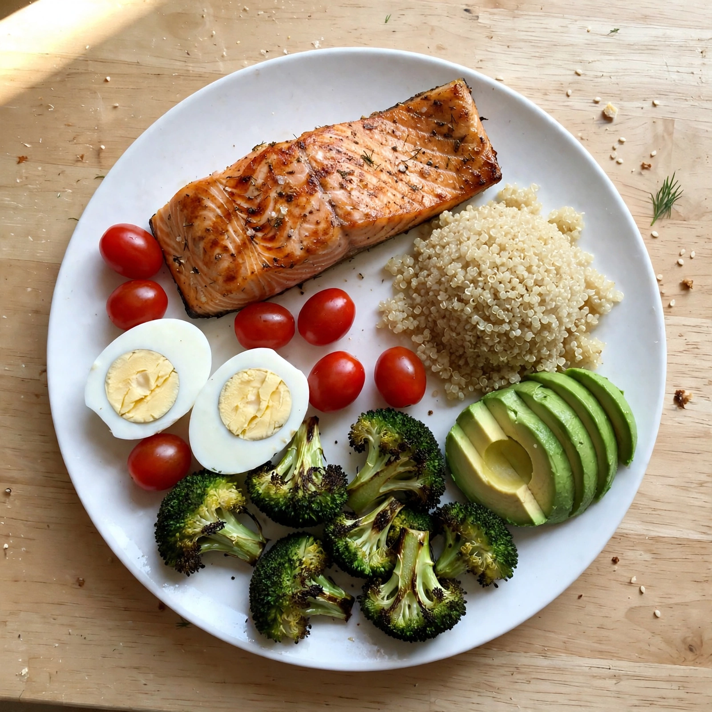
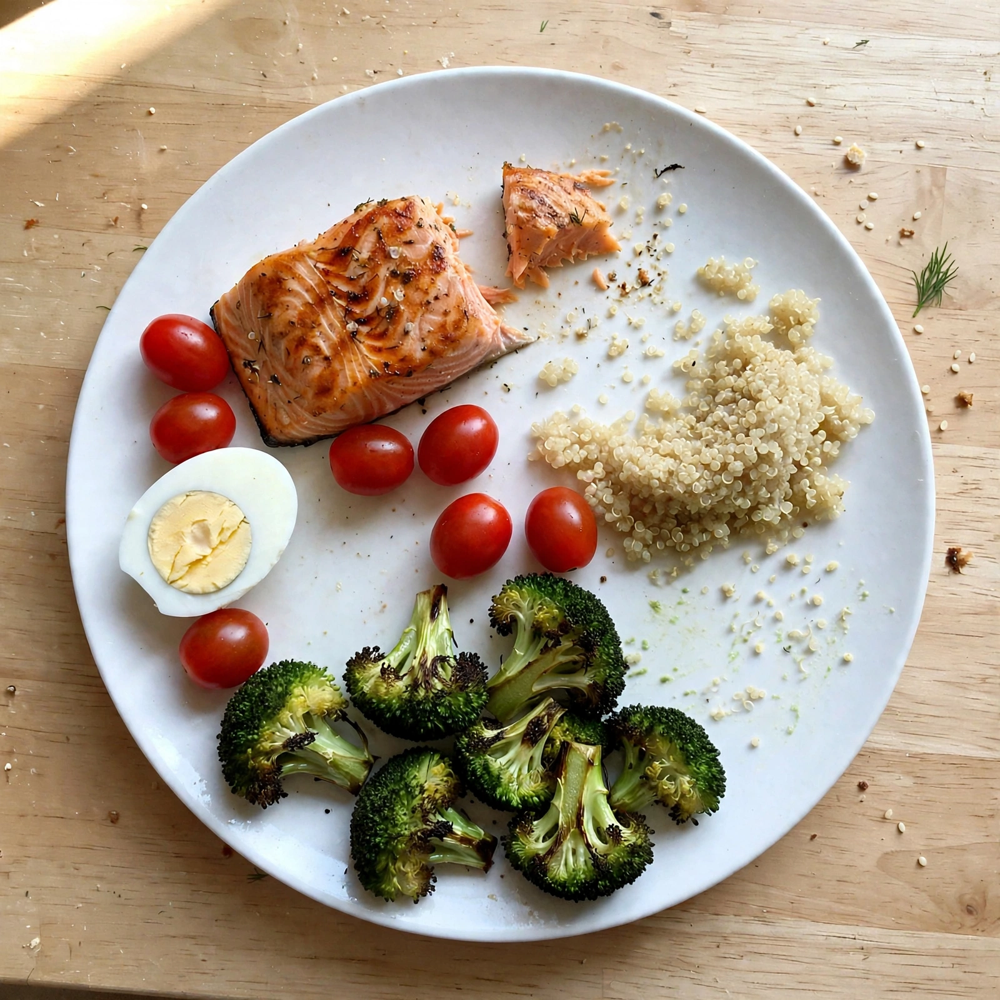

<p align="center">
  
</p>

<h1 align="center">GLPfit</h1>

<p align="center"><b>English</b> · <a href="README.ko.md">한국어</a></p>

<p align="center">
  <b>The weekly-shot companion for Mounjaro and Wegovy users.</b><br/>
  Weight, shots, photo-logged meals and exercise, coached by Meta AI around your injection cycle.
</p>

<p align="center">
  
  
  
</p>

<p align="center">
  
  
  <br/><sub>Plate Lens compares a before and an after photo to measure how much protein was actually eaten.</sub>
</p>

---

## Demo video

[Watch the 2-minute 48-second English demo on YouTube](https://youtu.be/DEE4_cbdePg). The edited walkthrough includes English narration, feature explanations and English captions. [Download the video](https://github.com/orqan137/glpfit/raw/refs/heads/main/glpfit-demo-final.mp4) or [English captions](glpfit-demo-final.en.srt). Waiting time is shortened; all app footage comes from a recorded session with a demo persona.

## Why

Mounjaro (tirzepatide, dual GIP/GLP-1) and Wegovy (semaglutide, GLP-1) are **once-a-week shots**, and people feel the week: appetite is lowest and nausea is common right after the shot, then appetite comes back before the next one. Weight drops fast, and **muscle goes with it** unless people get enough protein and do some strength work.

Most diet apps treat every day the same and make you type in food. GLPfit asks one question every day: **what day after the shot is it, and what should I do today?**

## Features

| | |
| --- | --- |
| **Home** | Four cards with the same shape: weight, shot cycle, protein today, exercise sets. |
| **Shots** | Log Mounjaro / Wegovy doses. Days since the shot, next due date, site rotation, missed-dose rule from the label, pens left from your prescription (often four weeks at a time in Korea) and when to see your clinic, today's side effects, and one chart: an **estimated relative drug-level curve** (from the label half-life) with each dose marked. |
| **Meals** | **Just take a photo.** Plate Lens finds every food, estimates protein and calories, and with an after photo measures what was actually eaten. Daily protein fills itself in. |
| **Exercise** | A bodyweight routine that follows the cycle (gentle right after the shot, strength on steady days, legs when appetite returns), plus **your own exercises** with reps and sets. |
| **Coach** | A chat agent that reads all of the above through tools, adapts to the cycle phase and remembers your patterns. Korean and English. |
| **Clinic PDF** | One tap prints the last 30 days of record tables without an AI call: dose history, symptoms by day after the shot and photo-estimated protein. An optional AI summary adds a write-up and questions for the clinician. |

## How it uses Meta AI

| Meta model | Used for |
| --- | --- |
| **SAM 3.1** | Plate Lens. Segmentation as a measuring tool: it counts and sizes each food in the before and after photos (e.g. 10 chicken slices → 3) to estimate what was eaten. |
| **Muse Spark** (vision, structured output) | Plate Lens. Names foods and estimates protein, kcal and leftovers under a strict JSON schema; its estimate and SAM's geometry cross-check each other. |
| **Muse Spark** (agent) | The coach. Calls our tools on its own and keeps multi-turn context. |
| **Muse Spark** (structured output) | An optional clinician-report summary, written from server-computed facts. Printing record tables requires no model call. |
| **Muse Voice Transcribe** | Voice check-in endpoint (`/api/voice-checkin`): speech → structured daily log, ready for a voice UI. |
| **Muse Image** | Generated and edited the before/after sample photos in this repo. |

### The coach agent

The coach follows the workspace-file pattern of agents like OpenClaw and Hermes:

- [`prompts/SOUL.md`](glpfit/agent/glpfit_agent/prompts/SOUL.md): who the coach is and what it cares about, safety first.
- [`prompts/AGENTS.md`](glpfit/agent/glpfit_agent/prompts/AGENTS.md): how it works each turn, which tools to call, answer format.
- Built per request: `TODAY` (language), `USER` (profile and where they are in the shot cycle) and `MEMORY` (facts the coach saved earlier).

Tools: `get_progress` (trends computed on the server, so the model never does arithmetic), `get_medication_schedule`, `get_coaching_tips`, and `remember`, which writes durable facts ("greasy food makes me nauseous") back into the person's memory and skips facts it already has. `USER` also carries today's numbers, so simple questions about today need no tool call.

## Safety

- No diagnosis, no prescribing, never suggests a dose change. Dose steps are shown as label reference only.
- The drug-level curve is a model from the label half-life and is labeled **not a measured blood level**.
- Every number is labeled as a self-log or photo estimate. Severe symptoms → contact a clinician.
- Data stays in the browser and is sent to the server only when you ask for coaching. Meta calls use `store=False`.

## Your data, then research (opt-in)

1. **Yours**: export everything as JSON, print the clinician PDF.
2. **Your clinic**: a standardized monthly report to support decisions your prescriber makes.
3. **Research**: with explicit consent, a de-identified dataset (`glpfit.rwd.v1`: relative days, drug and dose, weight change %, protein, symptom codes; no names, notes, dates or actual weight) that could become real-world evidence, such as which days after a shot side effects cluster.

## Getting started

Requirements: Node.js 24+, [uv](https://docs.astral.sh/uv/), a Meta Model API key from [dev.meta.ai](https://dev.meta.ai/).

```bash
git clone https://github.com/orqan137/glpfit.git
cd glpfit/glpfit
uv sync --locked
npm install --no-package-lock
cp .env.example .env        # then set MODEL_API_KEY=...
npm run dev                 # app: http://127.0.0.1:5173   API docs: /api/docs
```

On Windows PowerShell, `.\scripts\setup.ps1` does the install steps.

**Demo data:** open `http://127.0.0.1:5173/?demo=1` to load three weeks of shots, weights and side effects (add `&lang=en` for English).

**No key?** The app still runs in sample mode: shots, weight, exercise, the clinician fact table and both Plate Lens samples (with results computed earlier) work offline. Your own photos, the live coach and the written report need a key.

> Keys are read on the server only, from `.env` (`MODEL_API_KEY`) or `env.txt` (`META_API_KEY`). Both are git-ignored. Never put a key in frontend code or `VITE_*` variables.

## Project layout

```
glpfit/
├─ agent/glpfit_agent/
│  ├─ prompts/        SOUL.md, AGENTS.md
│  ├─ agent.py        coach loop, prompt assembly, sample mode
│  ├─ tools.py        tool schemas and execution
│  ├─ profile.py      user context, trends, USER section
│  ├─ medication.py   shot cycle phases, dose ladders, missed-dose rules
│  ├─ plate.py        Plate Lens (Muse Spark vision + SAM 3.1)
│  ├─ report.py       clinician report
│  └─ voice.py        voice check-in
├─ be/glpfit_be/api.py  FastAPI: /api/runs (SSE), /api/plate, /api/report, /api/voice-checkin
├─ fe/                  React + TypeScript + Vite PWA
└─ tests/               pytest, Meta responses mocked
```

## Development

```bash
cd glpfit
uv run --locked pytest          # 55 tests
uv run --locked ruff check .
npm test                        # 16 tests
npm run build
```

## Contributing

Issues and pull requests are welcome. Please keep health guidance conservative (see Safety), run the tests above, and never commit keys.

## License

[MIT](LICENSE)

---

[한국어 문서 읽기 →](README.ko.md)
